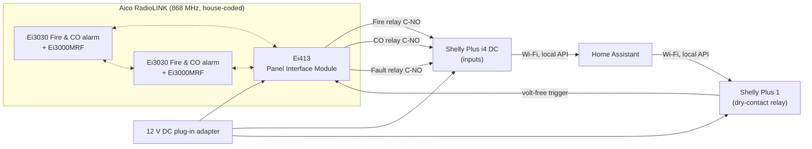
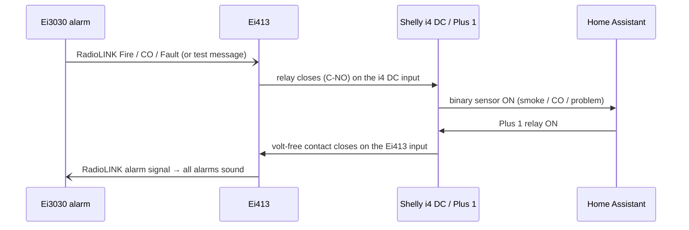

# Aico Fire & CO Alarm Interface: Ei413 → Shelly → Home Assistant

**Local, two-way integration of Aico RadioLINK fire/CO alarms with Home Assistant, without Aico's Ei1000G SmartLINK Gateway. An Ei413 RadioLINK Panel Interface Module provides volt-free Fire, CO and Fault relays into a Shelly Plus i4 DC. A Shelly Plus 1 drives the Ei413's trigger input, so Home Assistant can sound every alarm in the house. No cloud and no Aico gateway.**

[](https://www.youtube.com/channel/UC5Cupmz7vlfcodpCX7k8iuQ)
[](https://github.com/the-control-cabinet)


> **The short version:** two mains-powered Aico Ei3030 multi-sensor fire and CO alarms, each fitted with an Ei3000MRF RadioLINK module, are house-coded to an Ei413 panel interface. The Ei413's three volt-free relays (**Fire, CO, Fault**, wired C-NO) feed a **Shelly Plus i4 DC**, which shows them in HA as correctly classified binary sensors. A **Shelly Plus 1** relay drives the Ei413's input, so HA can **trigger every alarm in the house**. It's the same job a fire-alarm interface does on a commercial BMS, at domestic scale. The whole system was commissioned and tested end to end.

**Portfolio position:** Field level, life-safety interface. Related projects: [Modbus TCP](https://github.com/the-control-cabinet/modbus-tcp-data-collector) · [BACnet/IP](https://github.com/the-control-cabinet/bacnet-ip-network-explorer) · [Mains Water Metering](https://github.com/the-control-cabinet/mains-water-metering-modbus-rtu)

---

## Contents

1. [Objective](#1-objective)
2. [Scope](#2-scope)
3. [Deliverables](#3-deliverables)
4. [System architecture](#4-system-architecture)
5. [Points list](#5-points-list)
6. [Issues dealt with](#6-issues-dealt-with-summary)
7. [Testing](#7-testing-summary)
8. [Outputs](#8-outputs)
9. [Benefits](#9-benefits)
10. [Design limitations](#10-design-limitations)
11. [Video](#11-video)
12. [Quick start](#12-quick-start)
13. [Repository map](#13-repository-map)
14. [Roadmap](#14-roadmap)
15. [Skills demonstrated](#15-skills-demonstrated-bms--building-automation)
16. [Disclaimer and licence](#16-disclaimer-and-licence)

---

## 1. Objective

Bring the house's fire and CO alarm system into Home Assistant **locally and in both directions**, without the Aico cloud gateway:

- **Monitor:** Fire, CO and Fault states as HA binary sensors with the right device classes.
- **Command:** sound all the RadioLINK alarms from HA.
- **Keep it independent:** the Aico system keeps working exactly as before, whatever HA does.

This mirrors a standard BMS task: interfacing a fire alarm system through volt-free contacts, both receiving its alarms and sending it a trigger.

## 2. Scope

| In scope | Out of scope |
|---|---|
| Ei413 house-coded to the existing RadioLINK alarms | Changing or certifying the alarm system itself |
| Fire, CO and Fault relays → Shelly Plus i4 DC inputs | Alarm-level detail (which alarm, battery level, history) |
| Shelly Plus 1 relay → Ei413 input (sound all alarms) | Cloud gateway / Aico portal |
| HA entities, device classes, input types | Monitored (EOL) wiring (see [limitations](#10-design-limitations)) |
| Commissioning, house coding, test record | |

## 3. Deliverables

| # | Deliverable | Where | Status |
|---|---|---|---|
| D1 | Hardware, power and wiring schedule | [docs/01](docs/01-hardware-and-wiring.md) | ✅ |
| D2 | House coding and Shelly configuration | [docs/02](docs/02-house-coding-and-shelly-setup.md) | ✅ |
| D3 | HA entities and points list | [docs/03](docs/03-home-assistant-and-points-list.md), [data/](data/points-list.csv) | ✅ |
| D4 | Commissioning and test record | [docs/04](docs/04-commissioning-and-test-record.md) | ✅ |
| D5 | Issues log and lessons learned | [docs/05](docs/05-issues-and-lessons-learned.md) | ✅ |
| D6 | Alarm and interface-offline alert automations (deployed, tested) | [config/homeassistant/automations.yaml](config/homeassistant/automations.yaml) | ✅ |
| D7 | Photos | images/ | ⏳ to add |

## 4. System architecture



**Signal directions:**



## 5. Points list

HA devices (both in area **Control Room**): **Aico Smoke Alarm - Status** (Shelly Plus i4 DC) and **Aico Smoke Alarm - Trigger** (Shelly Plus 1).

| Point | Source | Contact | Shelly | HA entity | Device class | Normal | Alarm |
|---|---|---|---|---|---|---|---|
| Fire | Ei413 Fire relay | C-NO | Plus i4 DC, input 0 | **Fire Alarm** | smoke | Clear | Detected |
| CO | Ei413 CO relay | C-NO | Plus i4 DC, input 1 | **CO Alarm** | carbon_monoxide | Clear | Detected |
| Fault | Ei413 Fault relay | C-NO | Plus i4 DC, input 2 | **Smoke Alarm Fault** | problem | OK | Problem |
| Sound all alarms | HA command | Plus 1 dry contact | Plus 1 relay → Ei413 input | **Aico Smoke Alarm - Trigger** | switch | Off | On |

The i4 DC's fourth input (input 3) is spare. Entity IDs: Fire `binary_sensor.hall_aicom_smoke_alarm_input_0`, CO `…_input_1`, Fault `…_input_2`; Trigger `switch.control_room_shelly_plus_1_aicom_smoke_alarm_trigger`.

Full detail and the Shelly input type settings: [docs/03](docs/03-home-assistant-and-points-list.md).

## 6. Issues dealt with (summary)

| # | Issue | Fix |
|---|---|---|
| 1 | Shelly Plus 1 wouldn't power up or pair | 12 V DC polarity corrected to the Plus 1's DC supply terminals (the + was on the wrong one) |
| 2 | No way to tell if the Plus 1 was alive | It has no status LED; confirm via the Shelly app or web UI, or HA |
| 3 | Too many conductors on shared 0 V terminals | Commoned with Wago connectors, max two conductors per screw terminal |
| 4 | Pairing button did nothing | Power had to be right first, then pair |
| 5 | Inputs must give a steady on/off state, not button presses | Plus i4 DC inputs set to **Switch** type, so each appears as a binary sensor that follows the relay |
| 6 | Trigger relay must never fire or latch by accident | Plus 1 set to Detached, power-on **OFF**, auto-off **3 s** |

Full write-ups: [docs/05](docs/05-issues-and-lessons-learned.md)

## 7. Testing (summary)

Full record: [docs/04](docs/04-commissioning-and-test-record.md)

- **House coding:** the Ei413 was coded to both Ei3030 alarms.
- **Fire:** the alarm test button sends a test message, the Fire relay closes, and the HA smoke sensor turns on, then clears.
- **CO and Fault:** both outputs confirmed reaching HA with the correct classification (methods in the test record).
- **Command:** the Plus 1 relay triggers the Ei413, and all alarms sounded; the relay resets itself after 3 s.
- **Alerts:** the alarm alert and clear notification reached the phone; unplugging the supply produced offline alerts, then back-online alerts, and the alarms did **not** sound when power returned.
- **Independence:** the alarms still interlink and sound by themselves, whatever state HA is in.

## 8. Outputs

- Three correctly classified binary sensors (smoke, CO, problem) for dashboards, notifications and automations.
- An HA-controllable "sound all alarms" output.
- **Phone alerts** on Fire, CO or Fault becoming active and clearing, plus an alert if either Shelly drops off for 5 minutes (supply, Wi-Fi or device failure).
- A fully local path: HA uses each Shelly's local API, and Shelly Cloud is switched off.

## 9. Benefits

- **Awareness when away:** a fire or CO event can notify phones. On its own, the alarm is only audible inside the house.
- **Automations on alarm:** for example lights on, blinds open, HVAC/fans off to limit smoke spread. These are standard BMS fire-mode responses at domestic scale.
- **Whole-house warning from HA:** e.g. tied to another detector or a manual panic action.
- **No dedicated gateway needed:** Aico's own route into the alarms is the **Ei1000G SmartLINK Gateway**, about £180-£230 inc VAT at UK trade suppliers (October 2026). It's designed for landlords' remote monitoring: it reports over GSM to Aico's cloud portal, not to Home Assistant. This build uses an **Ei413** instead (about £40-£50 ex VAT) plus two Shellys and a plug-in adapter, and gets the alarm states into HA locally. See the [comparison](#gateway-comparison).
- **Transferable skill:** reading interface module documentation, volt-free contact interfacing, relay contact choice (NO/NC), and commissioning with a test record are everyday BMS integrator tasks.

### Gateway comparison

| | Aico Ei1000G SmartLINK Gateway | This build: Ei413 + Shelly |
|---|---|---|
| Typical price | About £180-£230 inc VAT | Ei413 about £40-£50 ex VAT, plus two Shellys and a 12 V adapter |
| Where data goes | GSM → Aico SmartLINK cloud portal | Local network → Home Assistant |
| Into Home Assistant | Not directly | Yes: three binary sensors and a trigger switch |
| Can sound the alarms | No | Yes (Shelly Plus 1 → Ei413 input) |
| Detail available | Per-alarm events (which alarm, head removal, etc.) | Fire / CO / Fault only, house-wide |
| Cloud or subscription | Cloud portal | None |
| Intended user | Social landlords and housing providers | Homeowner / integrator |

Prices are from UK trade suppliers in October 2026 and will vary. The gateway gives richer per-alarm detail. This build trades that for local control, HA integration, two-way operation and a lower cost.

## 10. Design limitations

- **Unsupervised wiring:** all three relays are wired **C-NO**, so a broken or disconnected wire looks the same as "no alarm". Commercial fire interfaces use NC contacts or end-of-line resistors so a wiring fault is detectable. See the [roadmap](#14-roadmap).
- **Shared supply:** a single plug-in adapter powers the Ei413 and both Shellys. If it fails, HA loses the interface (the Shellys go unavailable). The alarms themselves are mains-powered with battery back-up and keep working.
- **Status only:** the interface reports *that* Fire, CO or Fault occurred, not *which* alarm or what kind of fault.

## 11. Video

📺 [The Control Cabinet on YouTube](https://www.youtube.com/channel/UC5Cupmz7vlfcodpCX7k8iuQ). A video on this interface is planned.

<!-- Replace with the episode link once published: [▶ Watch](https://youtu.be/VIDEO_ID) -->

## 12. Quick start

1. Fit and power the Ei413 (11-30 V DC into its Vin terminals; this build uses a 12 V DC plug-in adapter) and **house-code** it to your RadioLINK alarms ([docs/02](docs/02-house-coding-and-shelly-setup.md)).
2. Power the Shelly Plus i4 DC and Plus 1 from the same 12 V DC supply, observing polarity on each device's DC terminals.
3. Wire the Ei413 **Fire, CO and Fault** relays (C and NO) to three Plus i4 DC inputs.
4. Wire the Plus 1's **dry-contact relay** to the Ei413's volt-free input.
5. In the Plus i4 DC's web UI, set the three inputs to **Switch** type (not Button) so each follows its relay as a steady on/off. On the Plus 1, set output type **Detached**, power-on action **Turn OFF** and **Auto-off 3 s**, so the trigger is always a short pulse and can never fire after a power cut.
6. Add both Shellys to HA (Shelly integration), then set each input's **Show as** to Smoke, Carbon monoxide or Problem.
7. Test with the alarm test button and record the results.

## 13. Repository map

```
.
├── README.md
├── CHANGELOG.md
├── LICENSE
├── config/
│   └── homeassistant/
│       └── automations.yaml           ← deployed alert automations
├── data/
│   └── points-list.csv
├── docs/
│   ├── 01-hardware-and-wiring.md
│   ├── 02-house-coding-and-shelly-setup.md
│   ├── 03-home-assistant-and-points-list.md
│   ├── 04-commissioning-and-test-record.md
│   └── 05-issues-and-lessons-learned.md
└── images/                            ← photos to add
```

## 14. Roadmap

- [ ] Photos of the installation and wiring.
- [ ] **Supervised wiring:** move Fault (and possibly Fire) to C-NC so a broken wire raises an alarm, and invert in HA.
- [x] **Phone alerts** for Fire, CO and Fault (active and cleared).
- [x] **Interface-offline alert:** either Shelly unavailable for 5 min, which also catches a supply failure.
- [x] Shelly Cloud off; Plus 1 fail-safes (Detached, power-on OFF, auto-off 3 s).
- [ ] Dashboard card for Fire, CO and Fault.
- [ ] Fire-mode automations: lights on, blinds up, fans/HVAC off.
- [ ] Monthly test reminder, plus a log of each test from the Fire sensor's history.

## 15. Skills demonstrated (BMS / building automation)

| Skill | Evidence |
|---|---|
| Value engineering | Met the requirement with an Ei413 interface instead of the dedicated cloud gateway; trade-offs documented |
| Fire alarm interfacing | Volt-free Fire/CO/Fault relays into a supervisory system; trigger output back to the system |
| Relay contact selection | C-NO vs C-NC trade-off documented, with the supervision limitation stated |
| Commissioning | House coding, input type set-up, device classes, test record |
| Alarm handling | Active/cleared notifications, plus a separate alarm for loss of the interface itself |
| Low-voltage power | 11-30 V DC module supply, DC polarity on mixed devices, terminal practice |
| Integration safety | Read-only monitoring inputs; trigger relay detached, off at power-up and self-resetting; the alarm system keeps working independently of HA |
| Handover documentation | Points list, wiring schedule, test record, limitations |

## 16. Disclaimer and licence

A personal monitoring and automation add-on. It is **not** part of, and doesn't replace, the alarm system's own detection, interconnection or maintenance. Don't rely on HA for life safety. [MIT Licence](LICENSE).

*Built and documented by James, August 2026 · part of [The Control Cabinet BMS portfolio](https://github.com/the-control-cabinet).*
